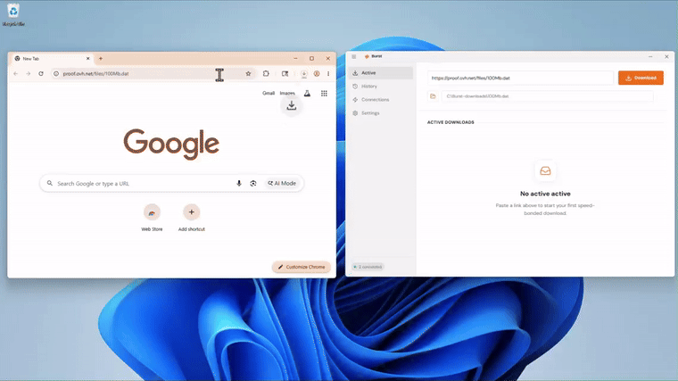

<div align="center">
  
  <h1>Burst</h1>
  <p><strong>Open-source multi-connection download accelerator for Windows, Linux, and macOS.</strong><br>
  Combine your Wi-Fi, Ethernet, and Mobile Hotspot into one aggregated, ultra-fast connection.</p>

  <p>
    <a href="https://sidhartsami.github.io/getburst/"><strong>Official Website</strong></a> &nbsp;&bull;&nbsp;
    <a href="https://github.com/SidhartSami/Burst/releases/latest"><strong>Download Releases</strong></a> &nbsp;&bull;&nbsp;
    <a href="#key-features"><strong>Features</strong></a> &nbsp;&bull;&nbsp;
    <a href="#browser-extensions"><strong>Extensions</strong></a> &nbsp;&bull;&nbsp;
    <a href="#quick-start"><strong>Quick Start</strong></a> &nbsp;&bull;&nbsp;
    <a href="#building-from-source"><strong>Build from Source</strong></a>
  </p>

  <p>
    <a href="https://github.com/SidhartSami/Burst/releases/latest"></a>
    <a href="https://github.com/SidhartSami/Burst/releases"></a>
    <a href="LICENSE"></a>
    <a href="https://github.com/SidhartSami/Burst/stargazers"></a>
  </p>
</div>

---

## What is Burst?

Most download managers are limited to a single physical internet connection. Even if your computer is plugged into Ethernet and simultaneously connected to high-speed Wi-Fi or a 5G mobile hotspot, standard software only utilizes one interface at a time.

**Burst** changes that. It bonds all available network interfaces into a unified pipe, parallelizing HTTP downloads and BitTorrent traffic across your **Wi-Fi, Ethernet, USB tethering, and cellular hotspots** simultaneously.

* **No paid hardware** or specialized bonding routers required.
* **No remote proxy subscriptions** or third-party VPN accounts needed.
* **100% free, MIT-licensed, and open source** with zero telemetry.

---

## Demo

<div align="center">
  
  <p>
    <em>Real-time multi-interface bonding, dynamic chunk map, and BitTorrent selective file picking in action.</em><br>
    <sub>HD video file: <a href="assets/demo.mp4">assets/demo.mp4</a> &bull; Interactive website demo: <a href="https://sidhartsami.github.io/getburst/">getburst.app</a></sub>
  </p>
</div>

---

## Downloads & Platform Support

Burst is distributed as native standalone executables with zero runtime dependencies.

| Platform | Format | Architecture | Direct Download |
| :--- | :--- | :--- | :--- |
| **Windows** | Setup Installer (`.exe`) | Windows 10 / 11 (64-bit) | [**Burst_Setup_v2.0.0.exe**](https://github.com/SidhartSami/Burst/releases/latest/download/Burst_Setup_v2.0.0.exe) |
| **Linux** | Portable AppImage (`.AppImage`) | Ubuntu 22.04+, Debian, Fedora, Arch (64-bit) | [**Burst-Linux.AppImage**](https://github.com/SidhartSami/Burst/releases/latest/download/Burst-Linux.AppImage) |
| **macOS** | Disk Image (`.dmg`) | macOS 12 Monterey+ (Apple Silicon & Intel) | [**Burst-Mac.dmg**](https://github.com/SidhartSami/Burst/releases/latest/download/Burst-Mac.dmg) |

---

## Comparison: Burst vs. Plexo vs. Traditional Tools

| Capability | Burst | Plexo | Traditional (IDM / FDM / aria2) |
| :--- | :---: | :---: | :---: |
| **Multi-WAN Interface Bonding** | ✅ **Yes** (Wi-Fi + Ethernet + 5G) | ✅ Yes | ❌ No (Single interface only) |
| **Pre-Built 1-Click Installers** | ✅ **Yes** (Windows `.exe`, Mac `.dmg`, Linux `.AppImage`) | ❌ No (Source build only) | ⚠️ Platform dependent |
| **Browser Companion Extension** | ✅ **Yes** (1-click `⚡ Burst` badge on `.zip`/`.exe`/`.iso`) | ❌ No extension | ⚠️ Basic intercept only |
| **Smart Interface Advisor** | ✅ **Yes** (Subnet & shared gateway collision warnings) | ❌ No (Silently underperforms) | ❌ No |
| **Per-Interface Speedtest** | ✅ **Yes** (Live Mbps & ping benchmarking) | ❌ No | ❌ No |
| **Persistent History & Resume** | ✅ **Yes** (1-click resume across app crashes/reboots) | ❌ No persistent history | ⚠️ Varies |
| **BitTorrent & Magnet Bonding** | ✅ **Yes** (libtorrent engine with file selective picking) | ❌ No (HTTP only) | ⚠️ FDM only |
| **Off-Peak Scheduler** | ✅ **Yes** (APScheduler with time triggers) | ❌ No | ⚠️ IDM only |
| **Per-Download Interface Pinning** | ✅ **Yes** (Allocate specific network adapters per job) | ❌ No (Global only) | ❌ No |
| **Open Source & Telemetry-Free** | ✅ **100% Free MIT** | ✅ MIT | ❌ Paid / Ad-supported |

---

## Key Features

###  True Multi-Connection Bonding & Interface Pinning
Plug in an Ethernet cable while connected to Wi-Fi, or enable USB tethering from your smartphone. Burst dynamically detects healthy network adapters, assigns distinct sockets, and aggregates their bandwidth. Pin specific interfaces per download to conserve metered connections.

###  Smart Interface Advisor (Network Collision Detection)
Plugging Wi-Fi and Ethernet into the same home router won't increase your speed because both share one ISP bottleneck. Burst detects subnet and gateway collisions, warning you in real-time and recommending mobile tethering or secondary networks for a true 2x speedup.

###  On-Demand Per-Interface Speed Benchmarking
Measure individual throughput and ping latency on each network adapter before starting large downloads. Know instantly if your secondary connection adds meaningful bandwidth.

###  Browser Extension 2.0 (Link Sniffer & 1-Click Badges)
Companion extensions for Chrome and Firefox detect direct download links (`.zip`, `.exe`, `.iso`, `.tar`, `.mp4`) and inject a sleek `⚡ Burst` badge. Click the badge to route the file through bonded acceleration without interrupting normal browsing.

###  Advanced BitTorrent & Magnet Engine
Built directly on top of `libtorrent`. Paste magnet links or drop `.torrent` files into the window to inspect metadata, browse file hierarchies, and selectively prioritize or exclude individual files before downloading begins.

###  1-Click History Resume & Crash Recovery
Downloads persist atomic chunk checkpoints. If Burst closes mid-download or the machine reboots, unfinished downloads recover cleanly. The History view provides 1-click re-downloading and native file manager reveal.

###  Off-Peak Download Scheduler
Queue heavy files for overnight downloads when your bandwidth is free. Set scheduled times directly from the add dialog or active download cards.

###  Real-Time Chunk Map & Observability
Observe download progress live. Burst features an interactive visual chunk map color-coded by network interface, giving you instant visual feedback on which connection downloaded which piece.

---

## Quick Start

### 1. Installation

#### Windows
Download [**Burst_Setup_v2.0.0.exe**](https://github.com/SidhartSami/Burst/releases/latest/download/Burst_Setup_v2.0.0.exe) and run the installer. The wizard configures desktop shortcuts and automatically registers Windows Firewall rules.

#### Linux
Download [**Burst-Linux.AppImage**](https://github.com/SidhartSami/Burst/releases/latest/download/Burst-Linux.AppImage), make it executable, and launch:
```bash
chmod +x Burst-Linux.AppImage
./Burst-Linux.AppImage
```

#### macOS (macOS 12 Monterey+ · Apple Silicon & Intel)
1. Download [**Burst-Mac.dmg**](https://github.com/SidhartSami/Burst/releases/latest/download/Burst-Mac.dmg) and open the disk image.
2. Drag **Burst** into your **Applications** folder.
3. On first launch, **right-click (or Control-click) Burst &rarr; Open** to bypass macOS Gatekeeper (since this community release is unsigned).

### 2. Connect Your Interfaces
Connect your computer to two or more network sources:
* **Option A**: Home Wi-Fi + Ethernet cable plugged into your router.
* **Option B**: Wi-Fi + Smartphone connected via USB cable with **USB Tethering** enabled.
* **Option C**: Built-in Wi-Fi + USB Wi-Fi adapter connected to a secondary network.

### 3. Start Accelerating
Open Burst — active adapters will appear in the top interface bar. Paste any download URL, magnet link, or drop a `.torrent` file to begin downloading at full speed.

---

## Browser Extensions

Capture browser downloads seamlessly with the official Burst companion extension:

| Browser | Installation Method |
| :--- | :--- |
| **Google Chrome / Brave / Opera / Vivaldi** | [**Chrome Web Store**](https://chromewebstore.google.com/detail/burst-download-manager/dgikbcilhfjcdaemdnadnokpmfejhcjb) or load unpacked `extension-chrome.zip` |
| **Microsoft Edge** | Install from Chrome Web Store or enable during setup |
| **Mozilla Firefox / Zen Browser / Floorp** | Load temporary add-on via `about:debugging` using `extension-firefox.zip` |

*Pre-packaged extension bundles are available on the [Releases page](https://github.com/SidhartSami/Burst/releases).*

---

## Building from Source

### Prerequisites
* **Python 3.11+**
* **Node.js 18+** & npm (for the React/Vite frontend)

### Clone & Setup

```bash
# Clone the repository
git clone https://github.com/SidhartSami/Burst.git
cd Burst

# Build the React frontend
cd frontend
npm install
npm run build
cd ..

# Install Python backend dependencies
# For Windows:
pip install -r requirements.txt

# For Linux:
pip install -r requirements-linux.txt

# Run Burst
python launch_linux.py   # Linux
python run_burst.py      # Windows
```

---

## Roadmap & Help Wanted

* **Linux Support** — Completed in v2.0.0 (GTK3 pywebview, multi-interface bonding, AppImage distribution).
* **macOS Support** — Completed in v2.0.0 (Native Cocoa backend, Apple Silicon & Intel DMG package).
* **Tail-Racing Benchmarks** — Evaluating racing heuristics on heavily asymmetric network setups.
* **Localization (i18n)** — Community translations for the UI.

Contributions of all kinds are welcome! Check out the [open issues](https://github.com/SidhartSami/Burst/issues) or submit a pull request.

---

## Frequently Asked Questions (FAQ)

<details>
<summary><strong>Do I need a special router or subscription?</strong></summary>
<p>No. Burst runs 100% locally on your machine. It binds standard OS networking sockets directly to each physical network interface.</p>
</details>

<details>
<summary><strong>How do I connect multiple internet connections?</strong></summary>
<p>The simplest methods are:
<ul>
  <li>Connect to Wi-Fi, then plug in an Ethernet cable to your router.</li>
  <li>Connect to Wi-Fi, then plug your phone in via USB and enable <strong>USB Tethering</strong> (using mobile data).</li>
  <li>Plug in an external USB Wi-Fi adapter to connect to a second Wi-Fi network.</li>
</ul>
</p>
</details>

<details>
<summary><strong>Does Burst support torrents and magnet links?</strong></summary>
<p>Yes. Burst includes a full BitTorrent client with DHT metadata resolution, peer exchange, and an interactive file selector.</p>
</details>

<details>
<summary><strong>Can I pause downloads and resume them later?</strong></summary>
<p>Yes. All HTTP and torrent downloads support pause and resume with SHA-256 chunk integrity validation.</p>
</details>

<details>
<summary><strong>Which operating systems are supported?</strong></summary>
<p>Windows 10/11 (64-bit), Linux (Ubuntu, Debian, Fedora, Arch via AppImage), and macOS 12 Monterey+ (Apple Silicon & Intel via DMG) are all officially supported.</p>
</details>

---

## License

Burst is open source under the [MIT License](LICENSE). Free for personal and commercial use.

<div align="center">
  <sub>Maintained by <a href="https://github.com/SidhartSami">Sidhart Sami</a> and contributors &bull; <a href="https://sidhartsami.github.io/getburst/">Website</a> &bull; <a href="https://github.com/SidhartSami/Burst">GitHub</a></sub>
</div>
